# lepayimio.es

Mi rincón autoalojado: un VPS con una docena de aplicaciones hechas a medida
para el día a día —notas, juegos, cartas Pokémon, recetas, listas, películas—
todas bajo el dominio `lepayimio.es` y con **un solo inicio de sesión**.

Este repositorio no tiene código: es el escaparate. Cada aplicación vive en su
propio repositorio dentro de la organización
[**Lepayimio**](https://github.com/Lepayimio).

> Las capturas están hechas con una cuenta de prueba vacía, así que no
> aparecen datos de nadie.

---

## Índice

- [Cómo está montado](#cómo-está-montado)
- [Entrada y portal](#entrada-y-portal)
- [Las aplicaciones](#las-aplicaciones)
  - [L-notes · notas](#l-notes--notas)
  - [L-games · emuladores](#l-games--emuladores)
  - [L-tcg · cartas Pokémon](#l-tcg--cartas-pokémon)
  - [RandomFact · un dato al día](#randomfact--un-dato-al-día)
  - [Recetas](#recetas)
  - [To do List](#to-do-list)
  - [GyMarks · gimnasio](#gymarks--gimnasio)
  - [L-archivos y L-films · subida y películas](#l-archivos-y-l-films--subida-y-películas)
  - [Descargas · L-torrents](#descargas--l-torrents)
  - [PomboMail · correo del dominio](#pombomail--correo-del-dominio)
  - [Asistente · Waddle Pi](#asistente--waddle-pi)
- [Otros proyectos](#otros-proyectos)
- [Repositorios](#repositorios)

---

## Cómo está montado

```
             Internet
                │
           Cloudflare
                │
   nginx  (un subdominio por app, HTTPS)
                │
 ┌──────┬───────┼────────┬────────┬─────────┐
portal  l-notes l-games  l-tcg   …         asistente
 Node   Django   Node     Node              Node + WebSocket
 └──────────────┴── sesión compartida ──────┘
```

- **Un VPS Debian** pequeño (2 vCPU, menos de 2 GB de RAM) sirve todo.
- **nginx** reparte cada subdominio a su aplicación; ninguna escucha fuera de
  la máquina.
- **systemd** arranca y vigila cada servicio por separado: si una app se cae,
  las demás siguen.
- **Sesión única (SSO).** El portal es el único sitio con usuario y
  contraseña. Al entrar firma un token y lo deja en una cookie del dominio
  padre; el resto de apps solo comprueban esa firma. Entras una vez y tienes
  todo.
- **Las películas no ocupan el disco del VPS**: viven en un almacenamiento
  externo montado por red, y Jellyfin las sirve desde ahí.
- **Correo propio** para el dominio.

La mayoría de las apps están hechas con **Node.js + Express**; las notas van
con **Django**, y el asistente usa WebSocket con reconocimiento y síntesis de
voz.

---

## Entrada y portal

Todo empieza en `lepayimio.es`. La pantalla de entrada permite «confiar en
este dispositivo» para que la sesión dure 30 días en vez de 12 horas.

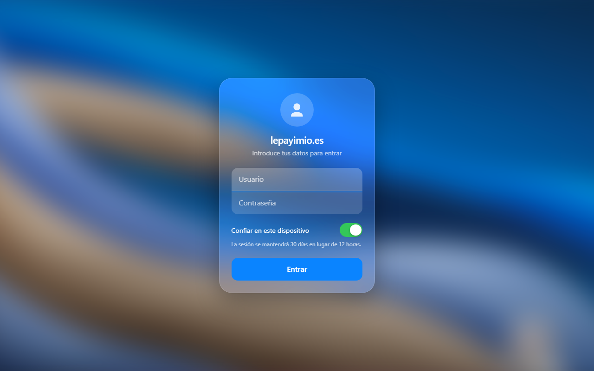

Una vez dentro, el portal es un escritorio al estilo de un móvil: reloj, el
tiempo del día y los iconos de cada servicio. Los iconos y el fondo se pueden
personalizar.

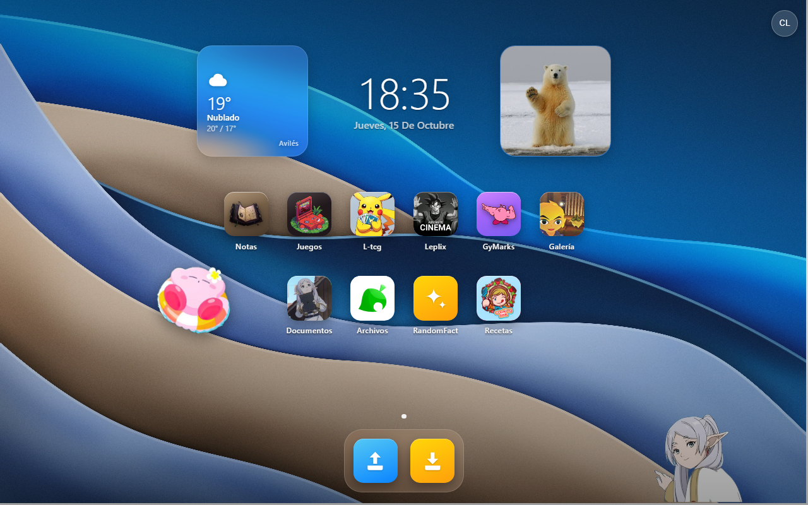

<p align="center">
  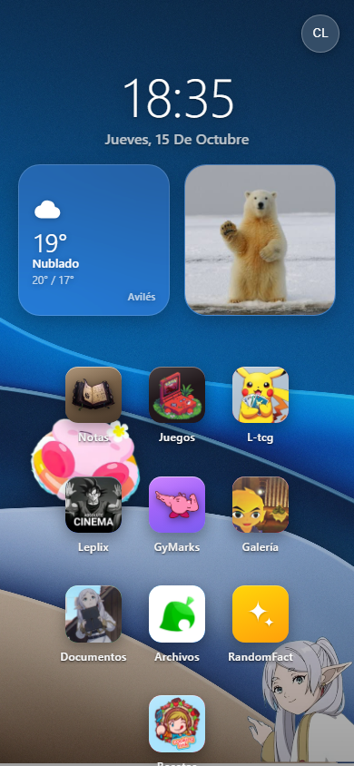
</p>

---

## Las aplicaciones

### L-notes · notas

`l-notes.lepayimio.es` — bóveda de notas en Markdown con carpetas, búsqueda e
importación de bóvedas enteras. Hecha con Django.

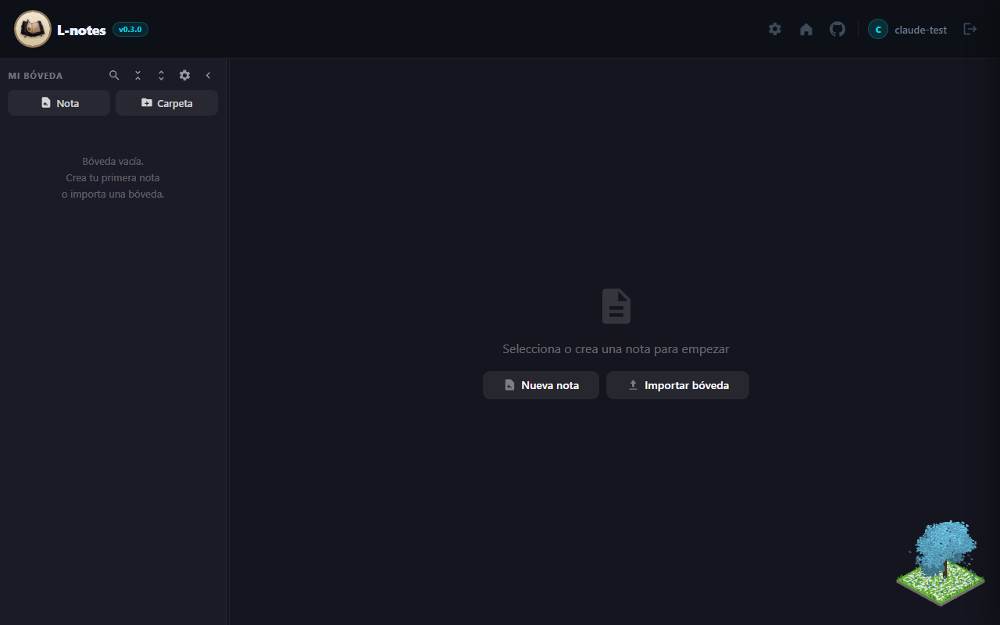

### L-games · emuladores

`l-games.lepayimio.es` — consolas retro en el navegador sobre EmulatorJS:
de NES a PlayStation pasando por Game Boy Advance o Mega Drive. Las partidas
se guardan por usuario, así que puedes empezar en el PC y seguir en el móvil.

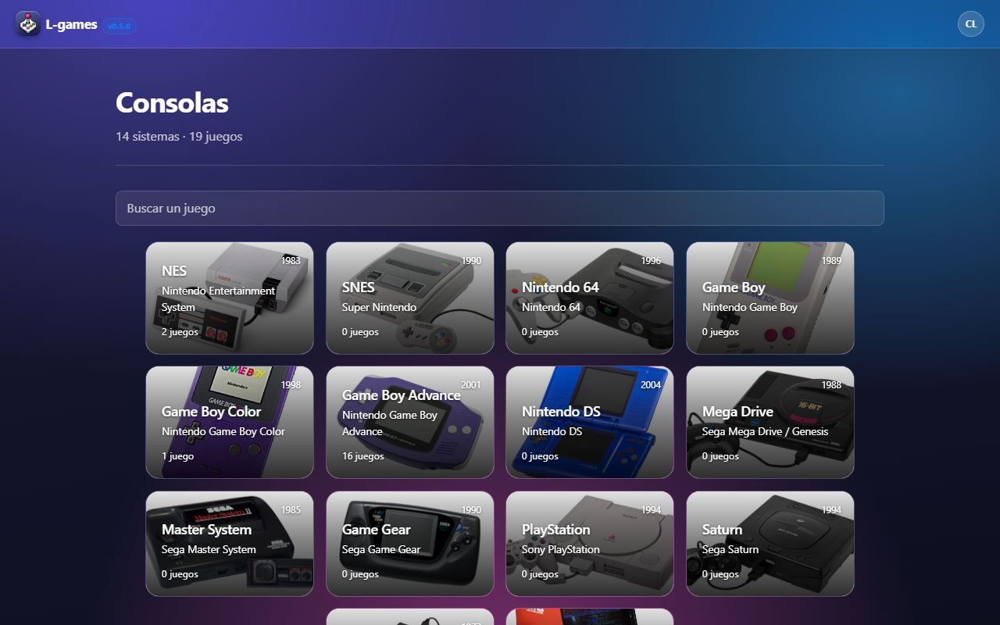

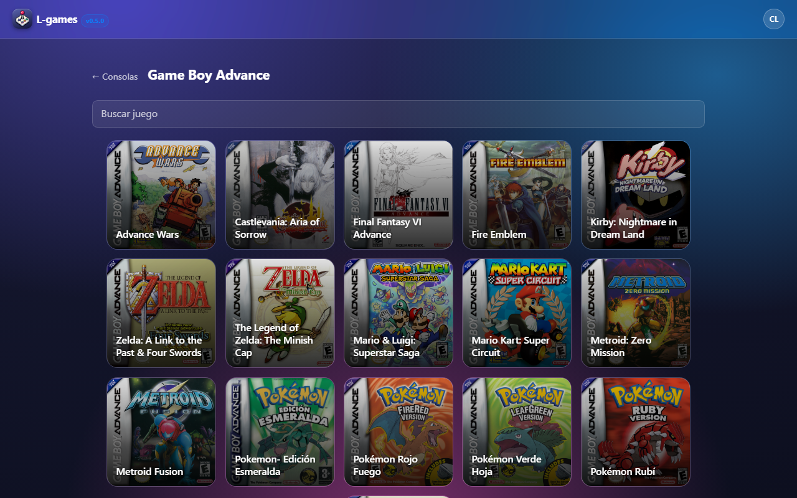

### L-tcg · cartas Pokémon

`l-tcg.lepayimio.es` — colección de cartas Pokémon con álbumes visuales,
enciclopedia de expansiones (también japonesas y chinas), lista de deseos y
amigos para comparar colecciones.

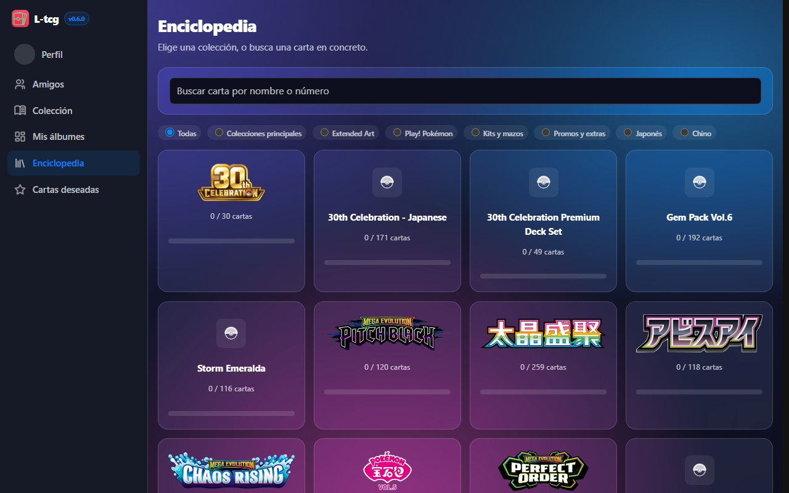

### RandomFact · un dato al día

`randomfact.lepayimio.es` — cada día, una curiosidad nueva sacada de
Wikipedia, museos con colecciones abiertas e iNaturalist, con imagen y el
artículo completo para leerlo sin salir. Lleva la cuenta de días seguidos.

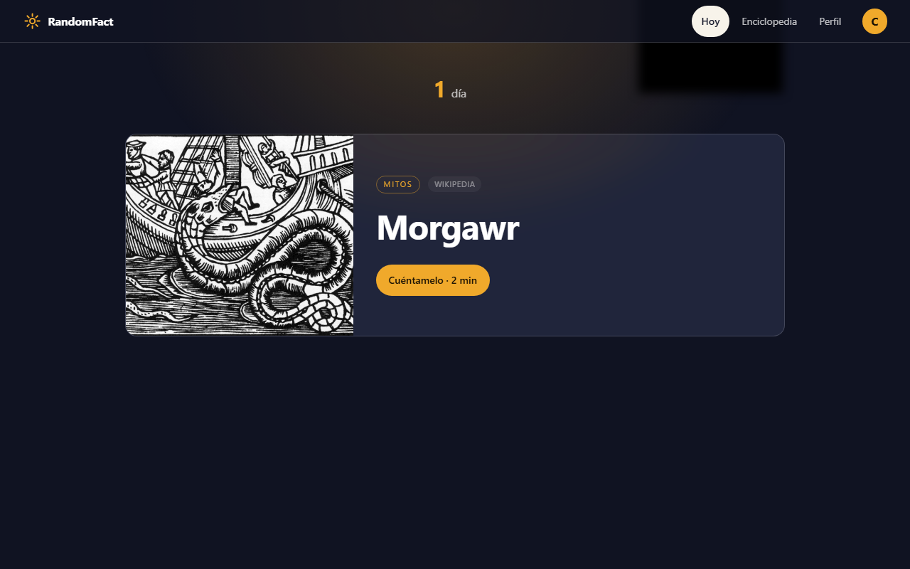

### Recetas

`l-recetas.lepayimio.es` — el recetario de casa, con búsqueda por nombre o
por ingrediente.

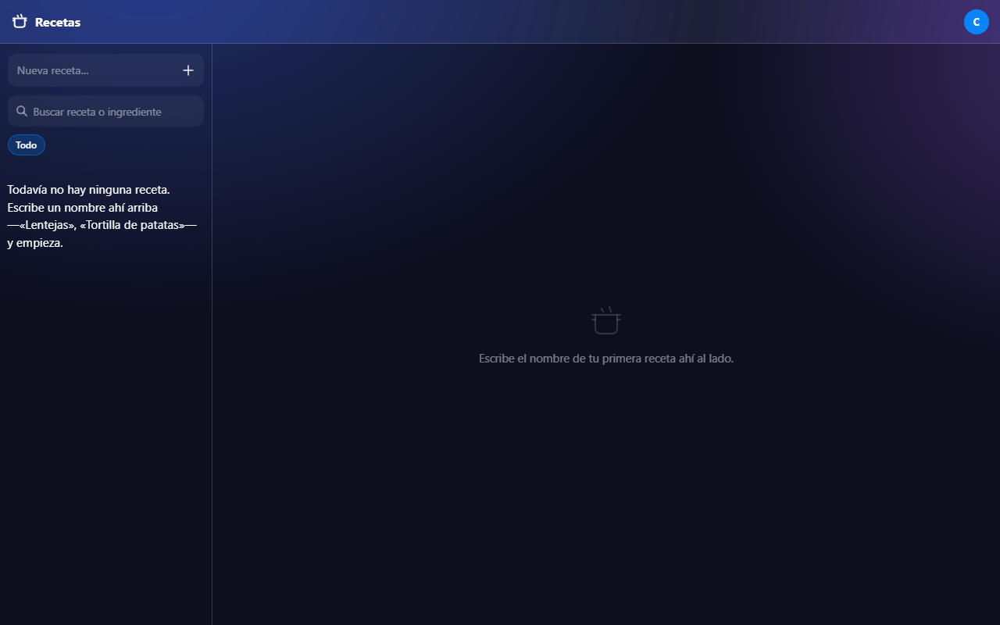

### To do List

`l-list.lepayimio.es` — listas de tareas con casillas, y un menú de la semana.

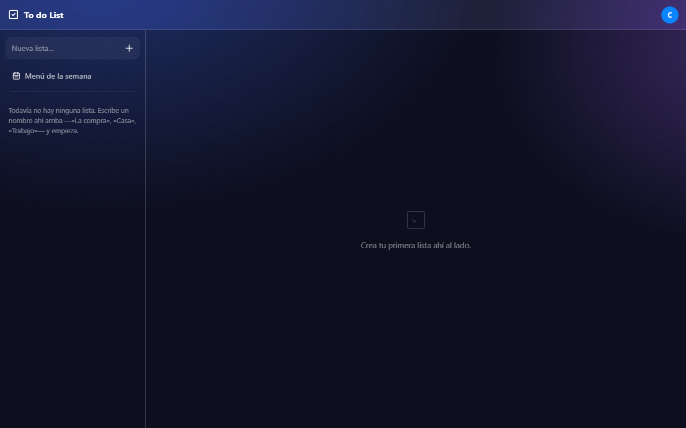

### GyMarks · gimnasio

`l-gym.lepayimio.es` — apunta rutinas por día y grupo muscular y mira cómo
progresas con el tiempo.

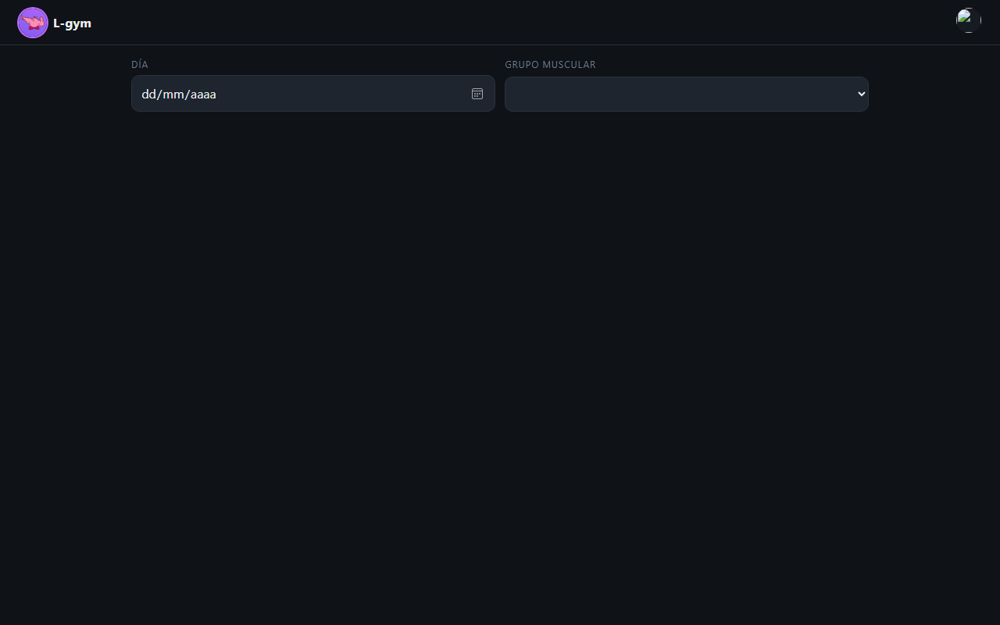

### L-archivos y L-films · subida y películas

`l-archivos.lepayimio.es` — buzón para subir películas, series, imágenes,
vídeos y documentos. Las películas y series se nombran solas a partir del
fichero y acaban en la biblioteca de **L-films**, un Jellyfin para verlas
desde cualquier sitio.

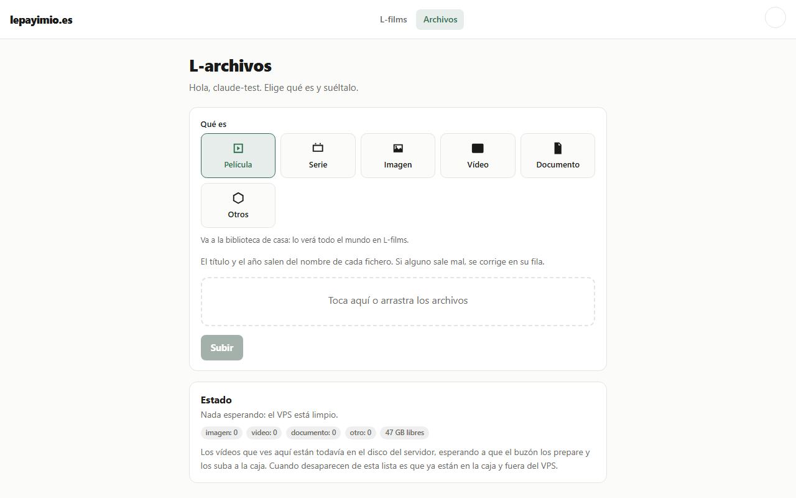

### Descargas · L-torrents

`l-torrents.lepayimio.es` — catálogo de descargas: busca en un indexador,
manda la descarga al cliente de torrents y deja el resultado directamente en
L-films.

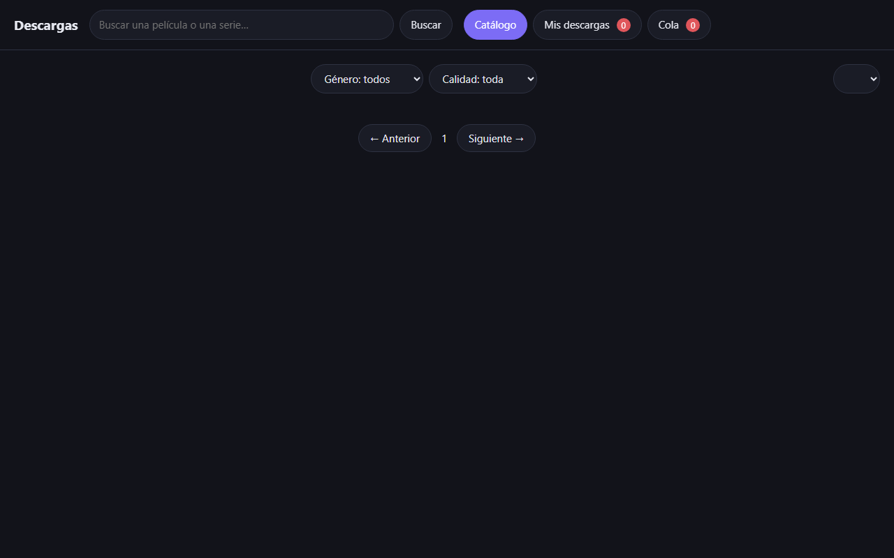

### PomboMail · correo del dominio

`pombomail.lepayimio.es` — para enviar correo como `@lepayimio.es` y ver lo
enviado. Como cualquiera que entre podría escribir en nombre del dominio,
**solo la abre el dueño**; el resto ve esto:

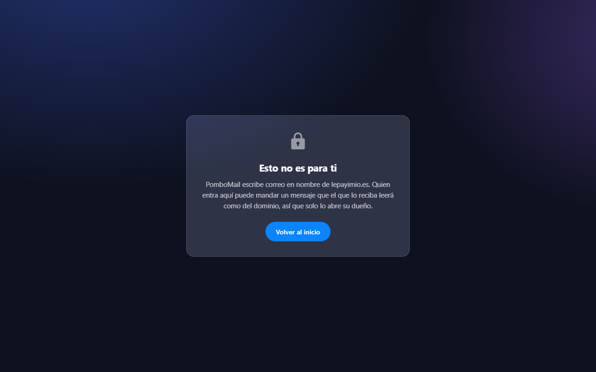

### Asistente · Waddle Pi

`asistente.lepayimio.es` — el cerebro de un asistente de bolsillo. Un
dispositivo con pantalla redonda (ESP32-S3) se conecta por WebSocket, manda la
voz y recibe qué decir y qué cara poner. Entiende órdenes fijas (hora, tiempo,
temporizadores…) y para lo demás pregunta a un modelo de lenguaje. La página
web es la misma cara que lleva el dispositivo.

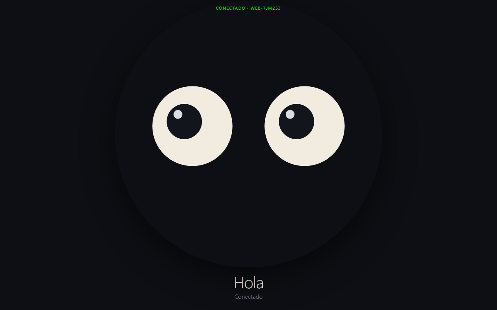

---

## Otros proyectos

- **Samuel Armas Tattoo** (`samuelarmastatto.lepayimio.es`) — web y agenda de
  citas para un tatuador.
- **L-shorts** — fábrica de vídeos cortos: guion → voz → imágenes → vídeo.

---

## Repositorios

| App | Repositorio | |
|---|---|---|
| Portal | [lepayimio-portal](https://github.com/Lepayimio/lepayimio-portal) | público |
| L-notes | [l-notes](https://github.com/Lepayimio/l-notes) | público |
| L-games | [l-games](https://github.com/Lepayimio/l-games) | público |
| L-tcg | [L-tcg](https://github.com/Lepayimio/L-tcg) | público |
| Recetas | [l-recetas](https://github.com/Lepayimio/l-recetas) | público |
| GyMarks | [l-gym](https://github.com/Lepayimio/l-gym) | público |
| L-archivos | [l-archivos](https://github.com/Lepayimio/l-archivos) | público |
| L-films (buzón) | [l-films](https://github.com/Lepayimio/l-films) | público |
| Descargas | [l-torrents](https://github.com/Lepayimio/l-torrents) | público |
| To do List | l-list | privado |
| PomboMail | pombomail | privado |
| Asistente | asistente | privado |
| Samuel Armas | samuelarmastatto | privado |
| L-shorts | l-shorts | privado |
| RandomFact | randomfact | privado |
| Infraestructura | lepayimio-infra | privado |
