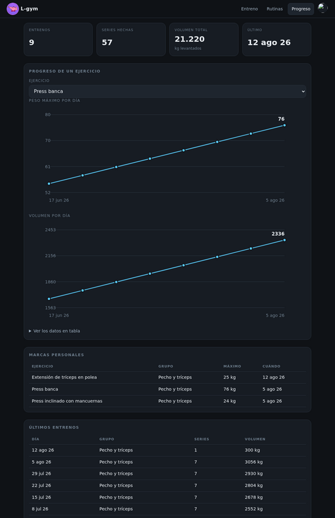
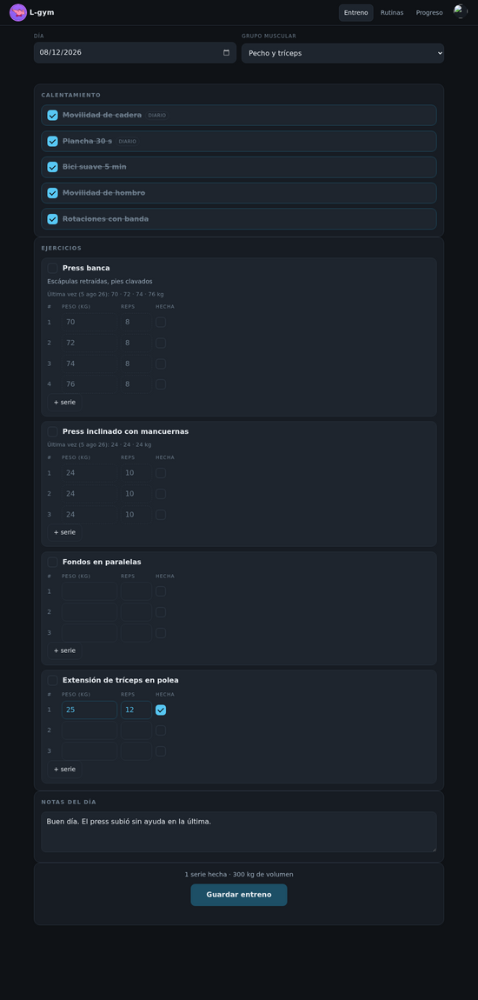
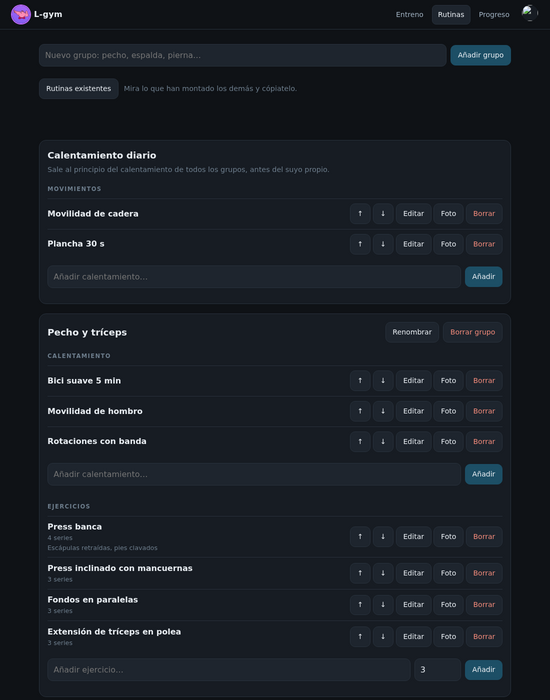
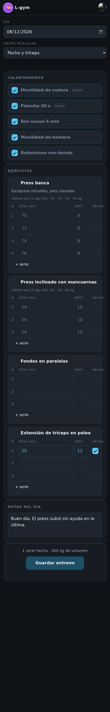

# Lepayimio

Resumen de los repositorios de la organización **Lepayimio**: las aplicaciones
autoalojadas que forman `lepayimio.es`. Todas corren en el mismo VPS, cada una
en su subdominio, y comparten **un solo inicio de sesión**.

> Las capturas están hechas con una cuenta de prueba vacía, así que no
> aparecen datos de nadie.

## De un vistazo

| Repositorio | Qué es | Dónde | Tecnología |
|---|---|---|---|
| [lepayimio-portal](https://github.com/Lepayimio/lepayimio-portal) | Entrada, sesión común y escritorio con todas las apps | `lepayimio.es` | Node / Express |
| [l-notes](https://github.com/Lepayimio/l-notes) | Bóveda de notas en Markdown | `l-notes` | Django |
| [l-games](https://github.com/Lepayimio/l-games) | Emuladores de consolas retro en el navegador | `l-games` | Node / EmulatorJS |
| [L-tcg](https://github.com/Lepayimio/L-tcg) | Colección de cartas Pokémon con álbumes | `l-tcg` | Node / SQLite |
| [l-recetas](https://github.com/Lepayimio/l-recetas) | Recetario de casa | `l-recetas` | Node / Express |
| [l-gym](https://github.com/Lepayimio/l-gym) | GyMarks: rutinas de gimnasio y progreso | `l-gym` | Node / SQLite |
| [l-archivos](https://github.com/Lepayimio/l-archivos) | Buzón de subida de películas, fotos y documentos | `l-archivos` | Node / Express |
| [l-films](https://github.com/Lepayimio/l-films) | Coloca lo subido en la biblioteca de Jellyfin | `l-films` | Node / Express |
| [l-torrents](https://github.com/Lepayimio/l-torrents) | Catálogo de descargas que acaba en L-films | `l-torrents` | Node / Express |

Los subdominios cuelgan de `lepayimio.es`.

## Cómo encajan

```
             Internet
                │
           Cloudflare
                │
   nginx  (un subdominio por app, HTTPS)
                │
 ┌──────┬───────┼────────┬────────┬─────────┐
portal  l-notes l-games  l-tcg   …        l-torrents
 └──────────────┴── sesión compartida ─────┘
```

- **El portal es el único sitio con usuario y contraseña.** Al entrar firma un
  token y lo deja en una cookie del dominio padre; el resto de apps solo
  comprueban esa firma. Entras una vez y tienes todo.
- **nginx** reparte cada subdominio a su app, y **systemd** arranca y vigila
  cada una por separado: si una se cae, las demás siguen.
- **Las películas no ocupan el disco del VPS**: viven en un almacenamiento
  externo montado por red. L-archivos y L-torrents las dejan ahí, L-films las
  coloca y Jellyfin las sirve.

---

## lepayimio-portal

**[Lepayimio/lepayimio-portal](https://github.com/Lepayimio/lepayimio-portal)** · `lepayimio.es`

La puerta de entrada. La pantalla de login permite «confiar en este
dispositivo» para que la sesión dure 30 días en vez de 12 horas.


Dentro, un escritorio al estilo de un móvil: reloj, el tiempo del día y los
iconos de cada servicio. Iconos y fondo se pueden personalizar.


<p align="center">
  
</p>

## l-notes

**[Lepayimio/l-notes](https://github.com/Lepayimio/l-notes)** · `l-notes.lepayimio.es`

Bóveda de notas en Markdown con carpetas, búsqueda e importación de bóvedas
enteras. Hecha con Django.


## l-games

**[Lepayimio/l-games](https://github.com/Lepayimio/l-games)** · `l-games.lepayimio.es`

Consolas retro en el navegador sobre EmulatorJS: de NES a PlayStation pasando
por Game Boy Advance o Mega Drive. Las partidas se guardan por usuario, así
que puedes empezar en el PC y seguir en el móvil.


## L-tcg

**[Lepayimio/L-tcg](https://github.com/Lepayimio/L-tcg)** · `l-tcg.lepayimio.es`

Colección de cartas Pokémon con álbumes visuales, enciclopedia de expansiones
(también japonesas y chinas), lista de deseos y amigos para comparar
colecciones.


## l-recetas

**[Lepayimio/l-recetas](https://github.com/Lepayimio/l-recetas)** · `l-recetas.lepayimio.es`

El recetario de casa, con búsqueda por nombre o por ingrediente.


## l-gym

**[Lepayimio/l-gym](https://github.com/Lepayimio/l-gym)** · `l-gym.lepayimio.es`

GyMarks: apunta rutinas por día y grupo muscular y mira cómo progresas con el
tiempo.



| Entreno | Rutinas | Móvil |
|---|---|---|
|  |  |  |

## l-archivos y l-films

**[Lepayimio/l-archivos](https://github.com/Lepayimio/l-archivos)** · **[Lepayimio/l-films](https://github.com/Lepayimio/l-films)** · `l-archivos.lepayimio.es`

Buzón para subir películas, series, imágenes, vídeos y documentos. Las
películas y series se nombran solas a partir del fichero, y l-films las
coloca en la biblioteca de Jellyfin para verlas desde cualquier sitio.


## l-torrents

**[Lepayimio/l-torrents](https://github.com/Lepayimio/l-torrents)** · `l-torrents.lepayimio.es`

Catálogo de descargas: busca en un indexador, manda la descarga al cliente de
torrents y deja el resultado directamente en L-films.


